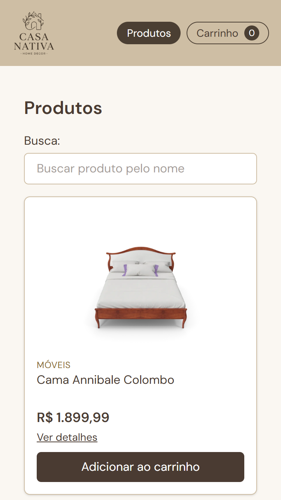
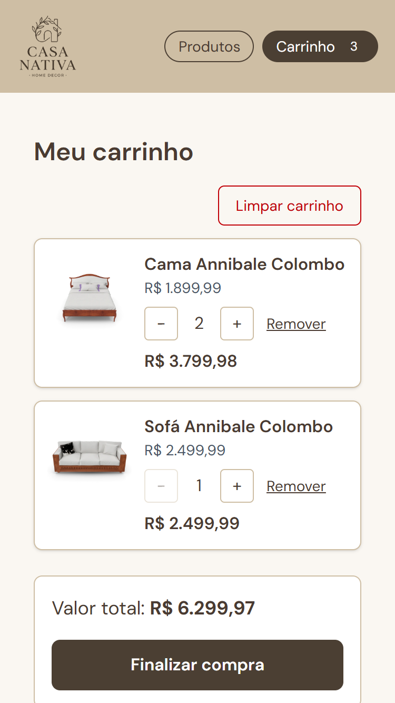
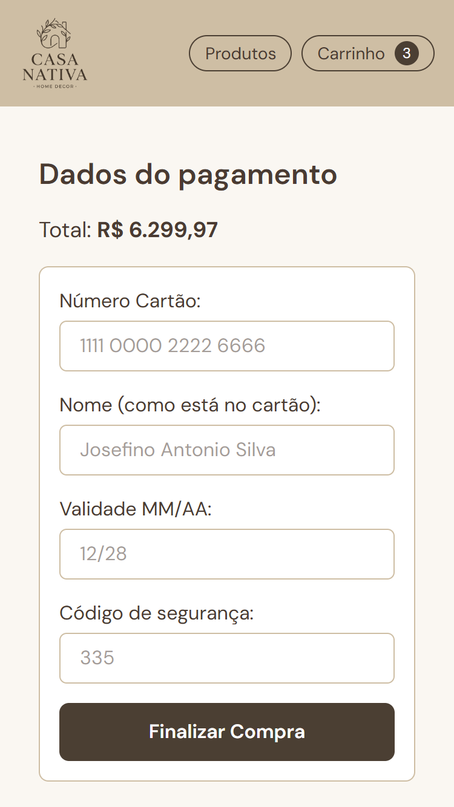

# 🛋️ Casa Nativa

Loja virtual de móveis e decoração, com catálogo, busca, carrinho e simulação de pagamento. Desenvolvida como projeto final avaliativo do módulo de Front-End React (SCTECH).

🔗 **Site publicado:** https://nativa-casa.netlify.app/produtos
📋 **Quadro no Trello:** https://trello.com/b/a6q1hjF0/projeto-loja-react-sc-tech
🎥 **Vídeo de apresentação:** 

## 💡 Problema que resolve

A Casa Nativa permite que o cliente navegue pelo catálogo, encontre produtos pelo nome, monte o próprio carrinho respeitando o estoque disponível e finalize a compra em um fluxo de pagamento validado, tudo em uma única aplicação.

## ✨ Funcionalidades

- Catálogo de produtos carregado de uma API simulada, com tratamento de carregamento, erro e lista vazia
- Busca por nome, sem diferenciar maiúsculas de minúsculas, com mensagem quando nada é encontrado
- Página de detalhe do produto em rota dinâmica, com tratamento de produto inexistente
- Carrinho global com Context API: adicionar, aumentar e diminuir quantidade, remover e limpar
- Limite de estoque: o botão fica indisponível quando o carrinho já tem todas as unidades
- Aviso visual de "Adicionado" ao incluir um produto no carrinho
- Contador de itens do carrinho no cabeçalho, atualizado em todas as páginas
- Carrinho salvo no `localStorage`, mantido ao recarregar a página
- Pagamento com formulário validado e processamento assíncrono simulado
- Rota privada: `/pagamento` só abre com itens no carrinho
- Telas de sucesso (limpa o carrinho) e de falha (mantém os itens e permite tentar de novo)
- Página 404 e layout compartilhado com cabeçalho e rodapé
- Interface responsiva (mobile-first)

## 📸 Telas

<table align="center" cellpadding="8">
  <tr>
    <td valign="top"></td>
    <td valign="top"></td>
    <td valign="top"></td>
  </tr>
</table>

## 🧰 Tecnologias utilizadas

| Tecnologia | Uso |
|---|---|
| React 19 + Vite | Base da SPA |
| React Router DOM | Rotas, rota de layout, rota dinâmica, rota privada e 404 |
| Context API + hooks customizados | Estado global do carrinho (`CarrinhoContext`, `useCarrinho`) |
| React Hook Form | Formulário de pagamento e validações |
| Tailwind CSS | Estilização e responsividade |
| PropTypes | Validação das props dos componentes |
| json-server (dependência de desenvolvimento) | API REST simulada para uso local |
| Vitest | Testes unitários |
| ESLint | Padronização do código |
| Netlify | Publicação |

## 🗂️ Estrutura do projeto

Organização por responsabilidade, separando componentes, páginas, estado global, hooks, serviços e regras de negócio.

```
loja-react/
├── db.json                  # produtos da API simulada
├── .env.development         # variável de ambiente para uso local
├── package.json
├── vite.config.js
├── README.md
└── src/
    ├── main.jsx             # ponto de entrada
    ├── App.jsx              # configuração das rotas
    ├── index.css            # estilos globais (Tailwind)
    ├── assets/img/          # logo, telas
    ├── components/          # Header, Footer, Layout, ProdutoCard, ItemCarrinho
    ├── context/             # CarrinhoContext
    ├── hooks/               # useCarrinho, useProdutos, useProduto, usePagamento
    ├── pages/               # Produtos, DetalheProduto, Carrinho, Pagamento,
    │                        # Sucesso, Falha, NaoEncontrada
    ├── routes/              # RotaPrivada
    ├── services/            # api.js (acesso aos dados)
    ├── utils/               # busca, moeda, pagamento (regras de negócio)
    └── tests/               # testes unitários
```

## 🧭 Rotas

| Rota | Página | Observação |
|---|---|---|
| `/` | — | Redireciona para `/produtos` |
| `/produtos` | Produtos | Lista da API e busca |
| `/produtos/:id` | DetalheProduto | Rota dinâmica com `useParams` |
| `/carrinho` | Carrinho | Itens, quantidades e total |
| `/pagamento` | Pagamento | Rota privada: exige itens no carrinho |
| `/sucesso` | Sucesso | Compra aprovada, limpa o carrinho |
| `/falha` | Falha | "tentativa de golpe" e botão "Tentar novamente" |
| `*` | NaoEncontrada | Página 404 |

## ▶️ Como executar

**Pré-requisito:** Node.js. O json-server já vem nas dependências do projeto e é instalado com o `npm install`.

```bash
# 1. Clonar e entrar na pasta
git clone [https://github.com/thiagoslongo/loja-react.git]
cd loja-react

# 2. Instalar as dependências
npm install

# 3. Iniciar a API simulada (terminal 1)
npm run api

# 4. Iniciar a aplicação (terminal 2)
npm run dev
```

A aplicação abre em `http://localhost:5173` e a API roda em `http://localhost:3001`.

### Variável de ambiente

O arquivo `src/services/api.js` decide de onde vêm os produtos com a variável `VITE_USAR_API`:

- `VITE_USAR_API=true`: busca na API do json-server (uso local, em `http://localhost:3001`)
- sem a variável (ou diferente de `true`): lê o `db.json` direto no front-end. É o modo usado na versão publicada, já que o json-server só roda localmente.

Para rodar com o json-server, crie o arquivo `.env.development` na raiz com:

```
VITE_USAR_API=true
```

### Outros scripts

| Comando | O que faz |
|---|---|
| `npm run dev` | Inicia a aplicação com o Vite |
| `npm run api` | Inicia o json-server na porta 3001 |
| `npm test` | Executa os testes |
| `npm run build` | Gera a versão de produção |
| `npm run preview` | Abre a versão de produção localmente |
| `npm run lint` | Verifica o código com o ESLint |

## 🧪 Testes

Testes unitários com Vitest, cobrindo caminho feliz e caminho triste:

- `formatarMoeda`: formatação de valores em reais
- `filtrarProdutos`: filtro por nome, sem diferenciar maiúsculas de minúsculas
- `todosDigitosIguais`: regra da "tentativa de golpe" no cartão
- `limparCartao`: remoção de espaços e hífens do número do cartão

```bash
npm test
```

## 🌿 Fluxo de Git

O desenvolvimento seguiu o fluxo com `develop` e feature branches, e o código final foi juntado na `main`. As branches foram mantidas após os merges.

| Branch | Objetivo |
|---|---|
| `feature/api-simulada` | `db.json`, json-server e serviço de acesso aos dados |
| `feature/listagem-busca` | Página de produtos, card e busca |
| `feature/detalhe-produto` | Rota dinâmica e página de detalhe |
| `feature/carrinho` | `CarrinhoContext`, hook e página do carrinho |
| `feature/layout-rotas` | Layout, cabeçalho, rodapé, rota privada e 404 |
| `feature/pagamento` | Formulário, validações e telas de sucesso e falha |
| `feature/estilos-responsividade` | Estilização e layout responsivo |
| `feature/testes` | Testes unitários |
| `feature/deploy` | Configuração de publicação na Netlify |
| `feature/aviso-adicionado` | Feedback visual ao adicionar ao carrinho |
| `feature/limite-estoque-carrinho` | Botão indisponível quando o carrinho atinge o estoque |
| `feature/melhorias-carrinho` | Botão de limpar carrinho e hover no remover |
| `feature/persistencia-carrinho` | Carrinho salvo no `localStorage` |
| `feature/ajustes-finais` | Ajustes finais do projeto |
| `feature/readme` | Documentação |

## 📌 Organização

As tarefas foram planejadas em um quadro Kanban no Trello: [link do quadro](https://trello.com/b/a6q1hjF0/projeto-loja-react-sc-tech).

## 🚀 Melhorias futuras

- Extrair um componente `BotaoAdicionar` reutilizável, já que a lógica se repete no card e na página de detalhe
- Testes de componente com React Testing Library e relatório de cobertura
- Filtro por categoria e ordenação por preço
- Sincronizar o termo de busca com a URL (`useSearchParams`)
- Tema claro/escuro
- Troca da janela de confirmação do navegador por um modal estilizado

## 👤 Autor

Thiago Resmini Slongo